# What Anthropic's IPO says about the whole AI industry

> **Animated version:** https://wilsonwu-ai.github.io/anthropic-ipo-explained/

*The first frontier AI lab to go public had to show its bills. They reveal how much of AI software is really chips, clouds and electricity.*

*Updated November 20, 2026, after the IPO. First published October 2026 from the S-1.*

> **The whole story in 30 seconds**
>
> Anthropic's IPO sold $81.34 billion of stock at $83 a share, the biggest ever by money raised, and seven suppliers and partners, including Google and NVIDIA, bought another $26.0 billion on the side. The shares opened 34% above the IPO price, closed day one up 17.1%, then fell 8.5% on day two as the Nasdaq 100 slid into a bear market. Underneath the price sits the bet the S-1 showed: fast-growing pay-per-use revenue on top of about $900.9 billion of committed spending on chips, clouds and data centers.

*Not investment advice; for understanding only. Nothing here says whether to buy, sell or hold.*

Anthropic, PBC filed its Form S-1 (the disclosure a company files with the SEC before selling shares to the public) on October 26, 2026: [read the S-1 on EDGAR](https://www.sec.gov/Archives/edgar/data/2130357/000162828026067168/anthropicpbc-sx1.htm). The final prospectus (the 424B4, dated November 18) filled in its blanks: [read the final prospectus on EDGAR](https://www.sec.gov/Archives/edgar/data/2130357/000162828026074944/anthropicpbc-424b4.htm). The stock trades on Nasdaq as ANT. Quotes from both filings are copied word for word. The first-half, third-quarter, nine-month and other quarterly 2026 figures are unaudited. Share prices are Yahoo Finance daily bars.

> **What changed since the first version**
>
> - **The blanks are filled.** A $70 to $78 range came on November 10; the deal priced at $83 for 980 million shares, $81.34 billion (Prospectus). The banks' option for another $12.20 billion was reported exercised (FT, citing the company).
> - **Two trading days.** ANT opened at $111.50 (+34.3%), closed day one at $97.17 (+17.1%) and day two at $88.91 (down 8.5%), still 7.1% above $83 (Yahoo Finance daily bars).
> - **A new quarter, unaudited.** Q3 revenue was $16,956 million, with a $567 million operating loss after a Q2 operating profit. Computing costs as a share of revenue, the one number to watch, rose to about 58% from 48% in Q2 (my calculation: 9,863 / 16,956; Section 6).
> - **A real price.** About $1.1 trillion on shares that exist at $83 (my calculation) and about $1.5 trillion fully diluted (reported): 13.7 to 22.1 times sales (my calculations), against 32 to 61 times in the first version.
> - **Three new sections up front** (the IPO, the co-founders, the crowd online); the old sections are now 4 to 12, updated where the IPO made them stale.

**The 3 answers up front**

The governing thought: **AI software is a hardware bet with a pay-per-use top line.** Revenue can move fast in either direction. Costs are signed for years. The IPO put a daily price on that bet.

1. **Where the money comes from:** mostly businesses paying per use (80% of first-half 2026 revenue), with nearly half of all sales flowing through the cloud stores of Amazon, Google and Microsoft (S-1).
2. **What the loss really is:** the net loss ($80.7 billion in the first half, $104.0 billion over nine months, unaudited) is mostly an accounting charge. The real exposure is about $900.9 billion of committed spending, $70.7 billion of it due in the 12 months after September 30 (Prospectus), against $10.8 billion of revenue under contract at June 30 (S-1).
3. **What the price assumes:** at $83, about $1.1 trillion on shares that exist (my calculation) and about $1.5 trillion fully diluted (reported by the FT). The market voted twice: up 17.1% on day one, down 8.5% on day two. The bear case is serious: slowing growth, a Q3 operating loss, an OpenAI price war, cooling credit and a court fight with Washington.

---

## 1. The IPO: biggest ever, by how much, and the first two days

Picture the biggest bake sale the school has ever held. The cookies sell out above the price on the sign, kids resell them in the hallway for even more, and by the next lunch the hallway price is back near the sign. The bake sale still raised its money.

This section has **6 points**.

**A record on every like-for-like count.** The base deal was 980 million shares at $83, or $81.34 billion (Prospectus), against SpaceX's $75.0 billion in June 2026 (SpaceX prospectus). With the banks' option (extra shares underwriters may buy at the IPO price), which the FT reported as exercised, citing the company ([FT, Nov 2026](https://www.ft.com/content/c7ad2e0c-efd1-40c2-a5a8-819ced8acf5b)), it is $93.54 billion against SpaceX's $86.25 billion. With the $26.0 billion private placement, it is $119.54 billion (my calculations). Saudi Aramco's $29.4 billion held the record from 2019 until SpaceX ([S&P Global, Jan 2020](https://www.spglobal.com/energy/en/news-research/latest-news/crude-oil/011220-aramco-ipo-value-to-rise-to-294-bil-with-exercise-of-over-allotment-option)).

**Not the most valuable debut, nor the biggest pop.** The FT reported that Anthropic's value at the end of day one ($1.3 trillion, or $1.75 trillion fully diluted) was below SpaceX's after its first day, and that SpaceX rose 19.2% on debut against Anthropic's 17.1% ([FT live blog, Nov 2026](https://www.ft.com/content/23fa83d8-e078-4853-959e-bd1f19d14ff5)).

**From a blank to $83.** The S-1 left the price blank; Amendment 2 on November 10 set $70 to $78 for 825 million shares. The deal priced $5.00 above the top of that range with 18.8% more shares, raising 33% more than the old midpoint and size implied (my calculations: $81.34 billion against $61.05 billion). The WSJ reported that investors asked for several times more shares than were offered ([WSJ, Nov 2026](https://www.wsj.com/finance/stocks/anthropic-sells-more-shares-than-planned-at-a-higher-price-than-expected-4b511002)).

**Two days, two votes.** Day one, November 19: open $111.50 (+34.3% versus $83), high $115.10, close $97.17 (+17.1%) (Yahoo Finance daily bars). So 34% was the open and 17.1% the close. Day two: low $83.05, five cents above the IPO price, and close $88.91, down 8.5% and still 7.1% above $83. Most of the first-day gain was given back. A buyer at the first trade was down about 20% (my calculation: 88.91 / 111.50, minus 1); a buyer allocated at $83 was up 7.1%.

**The backdrop was an AI sell-off.** On Friday the Nasdaq 100 fell 5.6%, ending 20% below its October 6 high, a bear market (a fall of 20% or more), and Nvidia fell 14% as the SEC reportedly probed its accounting ([FT, Nov 2026](https://www.ft.com/content/9f3c6ed6-c08f-4710-9683-ee2f5eb25841)). The bull read, from an FT Alphaville column: investors treated Anthropic as the AI stock to keep while selling the rest, though "a successful IPO doesn't necessarily translate into a positive market." ([FT Alphaville, Nov 2026](https://www.ft.com/content/017044a9-76dc-4cb4-9259-a844a96f2757)). The bear read, the WSJ's: the deal failed to revive the AI trade ([WSJ, Nov 2026](https://www.wsj.com/finance/stocks/anthropic-ipo-ai-markets-89e2476f)).

**Who got shares.** Orders topped $500 billion, and the FT reported that Claude was fed investor profiles and holding-period data to help weed out flippers (buyers likely to sell at once), with executives making the final calls ([FT, Nov 2026](https://www.ft.com/content/149d497e-0567-4467-bcfb-269b8b8eb157)). The prospectus says retail got less than 20% of the Class A shares offered; that FT report said about 13%, and an earlier one 15% ([FT, Nov 2026](https://www.ft.com/content/2b203097-7c61-464f-810f-962912a133dd)). The WSJ reported that investors and others were assigning blame for the day-two stumble, citing angry fund managers shut out of the offering and poor planning by the banks ([WSJ, Nov 2026](https://www.wsj.com/finance/stocks/the-blame-game-has-begun-over-anthropics-turbulent-trading-debut-280a34b1)).

**Why it connects:** the money pays toward the compute bill in Section 7, and the price is tested in Section 10. First, who got rich.

---

## 2. The seven co-founders: paper billionaires at four years, about $20 billion each at the IPO

Seven friends build a treehouse the whole town wants to visit. Neighbors say it is worth a fortune, but you can't spend a paper fortune at the candy store. The day tickets go on sale, the town puts a real price on it, and the seven promise to give most of their share away.

This section has **8 points**.

**Who they are.** Dario Amodei (chief executive), Daniela Amodei (president and board chair), Tom Brown (chief compute officer), Jack Clark (leads the Anthropic Institute), Jared Kaplan (chief science officer), Sam McCandlish (chief architect) and Christopher Olah (leads interpretability research, the study of what happens inside a model). Brown, Clark, Kaplan and McCandlish came from OpenAI (Prospectus). The filing says the seven, "as a group, are distinctly equipped to be stewards of our mission." (Prospectus, Prospectus Summary).

**Billionaires at about four years, $20 billion at almost six.** Anthropic was incorporated in January 2021 (Prospectus). By March 2025, about 4.1 years in, Bloomberg counted each co-founder above $1.2 billion ([Bloomberg, Mar 2025](https://www.bloomberg.com/news/articles/2025-03-04/anthropic-co-founders-become-billionaires-after-massive-funding-round)); Forbes estimated $16.6 billion each in June 2026 ([Forbes, Jun 2026](https://www.forbes.com.au/news/billionaires/fortunes-of-anthropics-seven-cofounders-more-than-double-to-16-6-billion-each/)). The IPO, 5.8 years after founding, priced each stake at $19.69 billion to $19.99 billion (my calculation: shares after the offering times $83). The NYT said about $25 billion each, likely on a different price or count.

**What each sold.** Each sold 3,378,378 shares, about $280.4 million gross (my calculation) and roughly 1.4% of each stake. Together that is all $1.96 billion of the deal's secondary shares (sold by existing holders, not the company) (Prospectus).

**What they control.** One Class F share, held by an LLC of the seven, carries 50.1% of all votes; with their own shares, the co-founders hold about 61.1% (Prospectus). The FT wrote that ordinary investors get almost no say ([FT, Nov 2026](https://www.ft.com/content/2b203097-7c61-464f-810f-962912a133dd)). The limit: Class F is redeemed for nothing after a 450-day transition that starts once fewer than three continuing founders remain for 90 days (Prospectus).

**The 80% pledge.** Each co-founder has pledged 80% of their personal equity in Anthropic to philanthropy (Prospectus), about $16 billion each at $83 (my calculation: 0.8 x $20 billion). The filing says: "These commitments are voluntary, revocable expressions of each co-founder’s philanthropic intent and do not constitute legally binding obligations." (Prospectus, Risk Factors). And: "The timing, amount, recipients, structure, and manner of any donations in furtherance of this pledge are uncertain" (Prospectus, Risk Factors).

**The lock-up.** No sales until the earlier of two trading days after Q3 2027 results or November 18, 2027 (day 365). Each may transfer up to 29% from the earlier of two trading days after Q1 2027 results or day 180 (Prospectus).

**Employees and investors got rich too.** Hill.com estimates cited by the WSJ suggest a majority of the 5,000-plus staff likely became millionaires ([WSJ, Nov 2026](https://www.wsj.com/tech/ai/thousands-of-anthropic-employees-and-investors-are-set-to-reap-fortunes-d9c3c6ed)). The NYT reported that some employee shares could be sold on day one, which Jay Ritter called unusual ([NYT, Nov 2026](https://www.nytimes.com/2026/11/19/technology/anthropic-2-trillion.html)). The bear side: every sellable share is future supply (Section 3).

**Benjamin Mann and the eighth billionaire.** The same NYT article counted at least eight billionaires minted. Mann is often called a co-founder, but "Mr. Mann is not a member of the Founder LLC nor a Continuing Founder" (Prospectus, Our Governance Structure and Its Goals). The filings do not name an eighth billionaire, and I have not assumed one.

**Why it connects:** founder control and the lock-up feed the governance story in Section 11, and the crowd in Section 3 is already trading on the lock-up calendar.

---

## 3. What the crowd says: X memes and TikTok, both sides

After a big game, the playground splits. Some kids say they knew the team would lose, some say wait until next week, a few swear they will never watch again, and one wears the jersey anyway. Nobody has checked the scoreboard twice.

This section has **4 points**, then a plain warning. Everything here is sentiment, not fact.

**X: six camps, no consensus.** A read-only sample of 35 posts from November 18 to 20 (incomplete, skewed to big accounts) split into: glad they skipped the open (about 26%), wait for lower (about 20%), never (about 17%), bell-ceremony memes (about 14%), bullish (about 14%) and buy-or-wait polls (about 9%). The biggest skipper meme, from Trung Phan, ribbed people who "missed the IPO pop" ([X, Nov 2026](https://x.com/TrungTPhan/status/2123833821137437001)), at about 820,000 views; a lock-up schedule image drew about 554,000 ([X, Nov 2026](https://x.com/sp3cul8r/status/2123434255737098646)). Unusual Whales relayed that Michael Burry has no plans to own the stock ([X, Nov 2026](https://x.com/unusual_whales/status/2122705568884515253)); a bullish memo pitched a future $10 trillion company ([X, Nov 2026](https://x.com/jonbma/status/2123126765413650594)).

**TikTok: bearish-leaning.** Of 15 videos, 7 were news or price recaps (CNBC and ABC News among them), 4 bearish, 3 mixed and 1 bullish. By likes among videos opened, bearish ones drew about 47,400 and the bullish one 4,700. The most-liked of those, a finance news-commentary account at 40,500 likes, called the IPO the last step before a bubble pops. Bulls cited the day-one gain and heavy demand; bears said great technology is not always a great business at $1.5 trillion.

**What each camp gets right and wrong.** Skippers are right that open buyers lost about 20% by Friday, and wrong if they call it a failed IPO: the money was raised and the stock closed 7.1% above $83. The wait camp is right that shares will unlock, and wrong to treat an unlock as a certain drop. The never camp's worry about circular money has a basis, since the placement buyers are also suppliers (Prospectus), but *circular* is a judgment. Bulls are right about growth, and wrong to read a pop as a promise. Flags: a bearish TikTok (6,900 likes) said the IPO "crashed markets," a causal claim nobody established, when the Nasdaq 100 was already 13% off its early-October peak on pricing day ([FT, Nov 2026](https://www.ft.com/content/62c0510b-ca65-441e-9baf-675b93903b9e)). A post calling $104.50 the IPO price was quoting a pre-IPO derivatives price, and posts promising Nasdaq-100 entry after day 7 are unverified.

**The supply calendar behind the lock-up memes.** This part is fact, from the prospectus. About 15.5 billion shares are locked up, about 16 times the 980 million sold (my calculation: 15.5 / 0.98). Up to 315 million could be sold from day one; up to 353 million unlock on February 2, 2027, and up to 1.7 billion after full-year 2026 results; the backstops are May 17, 2027 for most holders and November 18, 2027 for co-founders and large holders. The placement shares are unregistered, but "These shares will not be subject to market standoff agreements with us or lock-up agreements with the underwriters." (Prospectus, Concurrent Private Placement). The filing also lists "retail investor interest in our Class A common stock on an ongoing basis following this offering." as a factor that could move the price (Prospectus, Risk Factors). On the demand side, Nomura estimated about $26 billion of index buying as ANT joins Nasdaq and Russell indices ([FT live blog, Nov 2026](https://www.ft.com/content/23fa83d8-e078-4853-959e-bd1f19d14ff5)). Banks typically use their option to steady early trading; posts saying that support vanished are unverified.

**The plain warning.** None of this is a signal to buy, sell or wait. Posts measure mood, and the mood flipped in a day. Not advice.

**Why it connects:** the crowd argues about the price; Sections 4 to 9 are about what the price is a claim on, starting with the stack.

---

## 4. The AI stack: power, chips, clouds, labs, customers

A lemonade stand looks like one kid with a pitcher. Behind her are a farmer who grew the lemons, a company that made the cups, and a neighbor who owns the yard. When the stand sells a lot, everyone gets paid. When it doesn't, she still owes the farmer for lemons already ordered.

This section has **3 points**.

**Five layers, all named in the filing.** Power and data centers sit at the bottom. Then chips: NVIDIA GPUs (graphics processors used for AI math), Google TPUs and Amazon Trainium (custom chips the clouds design themselves) and AMD GPUs, most made by TSMC in Taiwan. Then clouds and compute sellers: Google, Amazon, Microsoft, SpaceXAI, Broadcom (through equipment leases), Nscale and Lambda. Then the labs, Anthropic and OpenAI. Then customers: businesses connecting through an API (a direct software link) or a cloud marketplace, and people on subscriptions (S-1, Business). In Anthropic's words: "We manage compute as a single, fungible pool from multiple strategic partners" (S-1, Business).

**NVIDIA is the toll booth, and lately the bank.** The S-1 names no NVIDIA-specific dependency in its risks, yet NVIDIA capacity reaches Anthropic through Microsoft, SpaceXAI, Nscale and Lambda (S-1). My [Sundai 145 article](https://wilsonwu-ai.github.io/sundai-145-panel-explained/) summarized [The Economist (Sep 2026)](https://www.economist.com/interactive/briefing/2026/09/03/nvidia-is-the-central-bank-of-ai): NVIDIA has pledged more than $70 billion to startups and $300 billion of support to its customers, earning it the label "central bank of AI." NVIDIA agreed to invest up to $10 billion in Anthropic ([Anthropic, Nov 2025](https://www.anthropic.com/news/microsoft-nvidia-anthropic-announce-strategic-partnerships)), and at the IPO it bought $10.0 billion of non-voting shares in the private placement, matched by Google, with AMD, Broadcom, Micron, Microsoft and TSMC buying the rest of the $26.0 billion (Prospectus). The stack bought into the lab it sells to.

**The real chokepoints are factories and power.** "The majority of the world’s most advanced chip manufacturing capacity is concentrated in Taiwan" (S-1, Risk Factors). The S-1 also names three memory makers and electricity as constraints.

**Why it connects:** every layer below the lab is paid on contracts, and Section 7 adds up that bill.

---

## 5. How Anthropic makes money

Some gyms charge a flat monthly fee. Others charge every time you swipe in. Anthropic is mostly the swipe-in kind, and the people swiping are mostly companies.

> In my words, from the S-1's numbers: **Anthropic's business generates revenue mainly from consumption-based, pay-per-use fees paid by organizations ($13.1 billion, 80% of first-half 2026 revenue), metered in tokens and priced by model, with 48% of all revenue sold through the cloud marketplaces of Amazon, Google and Microsoft. Subscriptions such as Claude Pro and Max are the smaller part ($3.2 billion, 20%).**

A token is a small chunk of text; customers pay per token processed. In the filing's words: "Pay-for-intelligence, our consumption-based revenue model, is our primary revenue model" (S-1, Management's Discussion and Analysis). This section has **3 points**.

**The mix is stable.** Consumption was 75% of revenue in 2024, 83% in 2025 and 80% in the first half of 2026; half-year revenue rose from $1.2 billion to $16.3 billion (S-1).

**The cloud giants are the sales channel.** Sales through CSP marketplaces (the online stores of cloud service providers) rose from about 11% of revenue in 2023 to 47% in 2025 and 48% in the first half of 2026 (S-1, Notes to Consolidated Financial Statements). Anthropic keeps the customer contract and pays each cloud a fee (S-1). So Amazon, Google and Microsoft are suppliers, sellers, customers and competitors at once, and after the IPO Amazon holds 14.6% and Google 13.4% of Anthropic's capital stock, all in non-voting shares (Prospectus).

**Big customers, no lock-in.** More than 11,900 customers spent $100,000 or more over the past year, up from more than 950 a year earlier, and customers at that level produced 74% of first-half revenue (S-1). Net revenue retention, which compares what the same customers spend now with a year ago, was about 900% (S-1). But the top five customers were about 25% of nine-month revenue, an estimated 5% to 7% came from customers later found breaking usage policy or commercial terms (S-1), and "Many of our top customers are not subject to long-term contracts with us" (S-1, Risk Factors).

**Why it connects:** revenue that can shrink fast sits on costs that cannot, the tension in Sections 6 and 7.

---

## 6. The burn, honestly

Imagine you promised a friend a slice of a trading card, and then the card became very valuable. On paper, your promise now costs more, so you show a loss. Your piggy bank hasn't changed. Most of Anthropic's giant loss is that kind.

This section has **3 points**: what is accounting, what is cash, and the cost trend.

**The $80.7 billion is mostly paper.** The first-half 2026 net loss was $80.7 billion, after $42.0 billion for all of 2025 (S-1). Of that, $72.4 billion is a fair-value change on convertible notes, derivatives and SAFEs (IOUs and early-investor contracts that later turn into shares), about 90% of the loss (my calculation: 72,388 / 80,748). "Because these instruments are marked to market" (S-1, Management's Discussion and Analysis), every rise in Anthropic's valuation raises the expense. The bridge: a $693 million operating loss, the $72.4 billion charge, $8.8 billion of other expense tied to note agreements, and $1.1 billion of interest income, plus a $21 million provision for income taxes (S-1). Over nine months the pattern held: a $104.0 billion net loss, about 91% of it the same kind of charge (my calculation: 94,324 / 104,039) (Prospectus, unaudited).

**The cash story is different.** Operating activities produced $3.9 billion of cash in the first half of 2026, against $1.5 billion used a year earlier (S-1), and $6.6 billion over nine months (Prospectus, unaudited). Q2 2026 earned $974 million of operating income, an 8% margin, after a $1.7 billion Q1 operating loss (S-1). Caveats: one profitable quarter is not a record, and some real costs are non-cash, including $2.2 billion of stock-based pay in the half (S-1). The S-1 left Q3 revenue blank but said it "was 86 times our revenue for the three months ended December 31, 2024" (S-1, Business), which I worked out as about $16.9 billion (86 x 197). The final prospectus gives $16,956 million, 46.7% above Q2 (my calculation), but Q3 swung to a $567 million operating loss (Prospectus, unaudited). Management expects more cash out: "we expect these investments to result in significant net cash used in operating and investing activities for the foreseeable future." (Prospectus, Management's Discussion and Analysis).

**Compute is shrinking as a share of revenue, unevenly.** Quarterly revenue rose from $376 million in Q1 2025 to $11.6 billion in Q2 2026, while compute and infrastructure fell from 251% of revenue to 48% (S-1), "as revenue growth outpaced the growth of our committed compute cost base." (S-1, Management's Discussion and Analysis). The chart stops at Q2, the last quarter in the S-1. In Q3 the share ticked back up to 58% (my calculation: 9,863 / 16,956), the quarter the operating result turned negative; over nine months it was 57%, against 172% a year earlier (Prospectus, unaudited). The S-1 shows no gross profit line; cost of revenue implies an 85.4% first-half gross margin on chips serving customers (my calculation: (16,286 minus 2,380) / 16,286), but all compute, including training, was about 55% of revenue (my calculation: 8,945 / 16,286), the more honest number.

**Why it connects:** the ratio fell because revenue outran costs already committed, and Q3 shows it can rise again. The next wave of commitments, in Section 7, is far larger.

---

## 7. The compute bill: why software is a hardware bet

Picture renting a giant bouncy castle for ten years because you expect lots of birthday parties. If the parties come, it's a bargain. If they don't, the rent is still due.

This section has **3 points**. One term first: take-or-pay means paying for capacity whether or not you use it.

**The bill, by counterparty** (S-1, Management's Discussion and Analysis):

| Counterparty | Commitment |
|---|---|
| SpaceXAI (NVIDIA GPUs) | up to $120.5B into 2029; about $3.1B a month once all capacity arrives (expected December 2026) |
| Google | at least about $114.5B to 2033, plus $125B to $150B of TPU compute outside the table |
| Amazon | at least $110.0B to 2036 |
| Broadcom (TPU leases) | about $161.2B (Risk Factors cites $125.2B for the 2026 lease; not reconciled) |
| Microsoft | at least $44.9B to 2033 |
| Nscale / Lambda | up to about $44.6B / about $41.3B |
| AMD | no fixed amount; expected above $20.0B |

The seven dollar amounts sum to $637.0 billion (my calculation), mixing firm minimums with ceilings. The notes to the financial statements show about $265.6 billion of fixed or minimum commitments at June 30 (unaudited), with terms of one to 20 years, plus about $245 billion signed since (S-1, Notes to Consolidated Financial Statements). The S-1 left the summary total blank; the final prospectus fills it in: about $900.9 billion of committed spending, substantially all for compute and infrastructure, with about $451.6 billion due before the end of 2030 and $70.7 billion in the 12 months after September 30 (Prospectus). Several deals bind Anthropic "regardless of actual usage" (S-1, Management's Discussion and Analysis). After early lock-in periods, though, the SpaceXAI agreements "may be cancelled by either party upon 90 days’ advance written notice." (S-1, Management's Discussion and Analysis).

**Fixed costs, flexible revenue.** The filing states the mismatch: "revenue is primarily consumption-based, and much of it is not subject to long-term contractual commitments" (S-1, Risk Factors). At June 30, revenue contracted but not yet earned was $10.8 billion (S-1), about 4% of the $265.6 billion (my calculation). After the IPO, cash and short-term investments of about $232.4 billion pro forma (Prospectus) cover about a quarter of the $900.9 billion total (my calculation: 232.4 / 900.9). SpaceXAI alone, at $37.2 billion a year, is about 55% of Q3 revenue annualized (my calculation: 37.2 / 67.8).

**Why a lab signs anyway.** Running short is as dangerous as running long: "In the past, we have significantly underestimated our compute requirements" (S-1, Risk Factors), and "These competitors can outbid us for scarce compute" (S-1, Risk Factors). So Anthropic pre-buys, and Wall Street finances the hardware, including a $63 billion bank-led deal to buy Broadcom chips for Anthropic that DealBook (NYT) reported in October 2026.

**Why it connects:** whether this bill is a bargain or a burden is the valuation question in Section 10.

---

## 8. Subscriptions: are Pro and Max users subsidized?

An all-you-can-eat buffet works because most people eat one plate. If a few guests eat twenty plates every night, the owner raises the price, shrinks the plates, or posts a sign: two trips per hour.

Subscriptions are 20% of Anthropic's revenue (S-1). This section has **3 points**, each graded one way: *confirmed* means the company's own page or post (an OpenAI executive's post on X counts), and *reported* means the press relayed it.

**Heavy users take far more than they pay, at list prices.** SemiAnalysis reportedly ran coding agents on every plan until limits hit: a $200 ChatGPT Pro plan was worth about $14,000 a month at API prices, a $200 Claude Max 20x about $8,000 ([Let's Data Science, Jun 2026](https://letsdatascience.com/news/chatgpt-200-plan-implies-up-to-14000-api-costs-48c1a8ca)). *Reported*, and these are list-price equivalents, not costs. The S-1 leaves these plans out of its retention metric, "excluding subscribers to our Claude Pro and Max plans" (S-1, Prospectus Summary), since a flat fee doesn't track usage.

**OpenAI rations through plan design.** It paused new $200 Pro sign-ups on September 10 ([TechCrunch, Sep 2026](https://www.techcrunch.com/2026/09/10/openai-puts-pro-subscriptions-on-hold-due-to-astra-demand)), *confirmed* by an executive post, then reopened at the same price with about half the API-dollar value, *confirmed* by an executive post, relayed. A further cut to the Pro allowance was [reported by OfficeChai (Oct 2026)](https://officechai.com/ai/openai-to-decrease-limits-on-pro-plan-from-20-times-to-10-times-of-plus-plan/). *Reported.*

**Anthropic rations through limits.** Prices remain $20, $100 and $200 ([Anthropic Help Center, Oct 2026](https://support.claude.com/en/articles/11049741-what-is-the-max-plan)). Five-hour Claude Code limits doubled in May 2026 with new SpaceX capacity ([Anthropic, May 2026](https://www.anthropic.com/news/higher-limits-spacex)), and Max plans carry a weekly limit on the Fable model ([claude.com/pricing](https://claude.com/pricing)). Those are *confirmed*. A September change to weekly limits was a 17% net cut against the boosted level, which Anthropic acknowledged to the press ([BleepingComputer, Aug 2026](https://www.bleepingcomputer.com/news/artificial-intelligence/anthropic-is-cutting-claude-codes-current-weekly-limits-by-17-percent/)). *Reported.* The pressure comes from agents, AI that runs long multi-step tasks, consistent with the S-1's warning that "our agentic offerings are structurally more compute-intensive" (S-1, Risk Factors).

My read: heavy users probably cost more than they pay, but neither company publishes cost per task, so "subsidized" is a strong inference, not a disclosed fact.

**Why it connects:** limits protect the compute ratio from Section 6, and OpenAI's harsher moves frame Section 9.

---

## 9. OpenAI: the rival that waited

Two kids race to open lemonade stands on the same street. One opens first, and everyone gets to look in its cash box. The other waits, borrows more from its parents, and keeps its box shut.

This section has **3 points**.

**OpenAI delayed; it did not cancel.** Sam Altman told Fortune that listing in 2026 would be ill-advised ([TechCrunch, Sep 2026](https://techcrunch.com/2026/09/12/openais-sam-altman-says-it-would-be-ill-advised-to-go-public-in-2026)). After Anthropic's debut, the PitchBook News newsletter reported that OpenAI had ruled out a 2026 IPO, with its CFO, Sarah Friar, pointing to 2027 (Nov 2026).

**Its valuation drifted up, then down.** OpenAI was valued at $852 billion after a March 2026 round ([AI Weekly, Aug 2026](https://aiweekly.co/alerts/openai-buys-7b-in-employee-stock-holds-valuation-at-852b)) and then sought about $1.4 trillion ([AI Weekly, Sep 2026](https://aiweekly.co/alerts/openai-targets-30b-bridge-round-at-14t-pushes-ipo-to-2027)). The WSJ reported it raised at $1.25 trillion instead, and that Anthropic's revenue passed OpenAI's in the spring and summer ([WSJ, Nov 2026](https://www.wsj.com/tech/ai/anthropic-vs-openai-the-financial-metrics-behind-the-ai-battle-4f5b90c0)). Same standard for both: Anthropic's figures are filed with the SEC; OpenAI's are leaks and figures shown to investors.

**Gross versus net revenue distorts every comparison.** When Anthropic sells through AWS or Google Cloud, it books the full customer payment and counts the cloud's cut as a cost; OpenAI books only its net share of sales through Microsoft ([Bloomberg Government, Oct 2026](https://news.bgov.com/artificial-intelligence/openais-annualized-revenue-nears-50-billion-ft-says)). The same customer dollar looks bigger on Anthropic's books. That helps explain why OpenAI's annualized revenue was put at about $50 billion by the FT (same source) and nearly $70 billion by Axios ([Bloomberg Government, Sep 2026](https://news.bgov.com/artificial-intelligence/openais-annualized-revenue-nears-70-billion-axios-says)); both are run-rates, not audited. It cuts both ways: OpenAI's side said Anthropic's spring $30 billion run-rate was overstated by about $8 billion, a rival's assertion that App Economy Insights reported (Oct 2026) and that I could not verify. Meanwhile the S-1 warns rivals may sell "products at zero or negative margins to gain market share" (S-1, Risk Factors), and OpenAI halved its GPT-6 Sol and Luna API prices in September ([The Next Web, Sep 2026](https://thenextweb.com/news/openai-gpt-6-sol-luna-api-price-cut)).

**Why it connects:** any Anthropic-versus-OpenAI multiple in Section 10 inherits this accounting gap.

---

## 10. Is the valuation too high? The equity-research view

If a lemonade stand earns $10 a day, what would you pay to own it? If you believe it will soon earn $100 a day, you'd pay much more. The price is a guess about the future, and guesses miss in both directions.

The first version had to use reported valuations because the S-1 left the price blank. Now there is a price. This section has **5 points**.

**Two ways to count the same company.** Basic market value counts shares that exist: 13,366,642,276 if the banks' option is exercised in full, which the FT reported (Prospectus), including 846,840,960 held by Anthropic's own Public Benefit Fund. Fully diluted adds promised shares, such as 1,774,342,693 options and 1,026,660,010 unvested RSUs (stock awards that vest over time) (Prospectus). The prospectus gives no single fully diluted count, so every fully diluted figure is an estimate. At $83, basic is about $1.109 trillion (my calculation: 13.37 billion x $83); the FT put fully diluted at about $1.5 trillion. The NYT's $2 trillion headline was fully diluted at the opening price ([NYT, Nov 2026](https://www.nytimes.com/2026/11/19/technology/anthropic-2-trillion.html)); the WSJ walks through the gap ([WSJ, Nov 2026](https://www.wsj.com/finance/investing/is-anthropic-worth-1-1-trillion-or-1-5-trillion-how-to-make-sense-of-the-valuations-721b4df8)).

**The multiples at the actual price** (price-to-sales, value divided by a year of revenue; my calculations). Run-rate revenue is an operating metric that annualizes the latest 28 days, not GAAP revenue: "Run-Rate Revenue was approximately $81 billion as of October 31, 2026, up $10 billion from September 30, 2026." (Prospectus, Business). Q3 is unaudited.

| Value basis | Value | On run-rate ($81B) | On Q3 x 4 ($67.8B) |
|---|---|---|---|
| Basic at $83 (option reported exercised) | $1.109T | 13.7x | 16.4x |
| Basic at the Nov 20 close ($88.91, option reported exercised) | $1.188T | 14.7x | 17.5x |
| Fully diluted at $83 (reported, FT) | $1.5T | 18.5x | 22.1x |

**Then versus now.** The first version used reported values of $1.5 and $2 trillion on older revenue: about 46x and 61x on first-half revenue times two, 32x and 43x on Q2 times four. Two things moved. Revenue grew: Q3 times four is $67.8 billion, against $46.2 billion for Q2. And the price landed at the low end of the talk, roughly a 1.5x step-up from the $965 billion May round, as the PitchBook News newsletter put it (my calculation: 1,500 / 965 = 1.55). The dashed 30x line in the chart is the reported reference from the first version (Morning Brew, Aug 2026, citing the FT); at 22.1x on the fullest count, the IPO priced below it. Peers I checked on October 27 had a median trailing EV/sales of 17.1x, which on Q3 x 4 implies about $1.16 trillion (my calculation: 17.1 x 67.8), but those prices predate the sell-off.

**Bull and bear, equal room.**

The bull case:

- Customers spending $100,000 or more grew from over 950 to over 11,900 in a year; net revenue retention is about 900% (S-1; Prospectus).
- Run-rate revenue rose $10 billion in October alone (Prospectus). Goldman analysts expect more than $440 billion of annual revenue by 2029, the NYT reported (same article); that is a forecast, not a fact.
- Compute fell from 172% of revenue in the first nine months of 2025 to 57% in 2026, and nine-month operating cash flow was positive $6.6 billion (Prospectus, unaudited).
- Cash and short-term investments are about $232.4 billion pro forma (Prospectus), second only to Alphabet's $265 billion among tech firms, The Economist reported ([The Economist, Nov 2026](https://www.economist.com/business/2026/11/19/anthropic-soars-but-it-may-soon-be-back-cap-in-hand)).
- The company believes in "demand for AI that outstrips supply for the foreseeable future" (S-1, Business). That is a belief, not a fact; if it holds, take-or-pay is pre-bought scarcity.

The bear case:

- Growth is slowing from a peak: sequential growth was 132% in Q1 2026 (S-1), about 144% in Q2 (my calculation: 11,555 / 4,731, minus 1) and 46.7% in Q3 (my calculation: 16,956 / 11,555, minus 1).
- Q3 swung to a $567 million operating loss after a Q2 operating profit, and compute rose back to 58% of revenue (Prospectus, unaudited; my calculation).
- Prices fall while inputs don't: token prices roughly halved since May as GPU rental prices rose, per Silicon Data via the Daily Upside (Oct 2026), and Anthropic cut its latest Fable model's price by 20% in November ([FT, Nov 2026](https://www.ft.com/content/aa8290dc-a20a-45af-97ab-1e71f97f236a)). Open-weight models "could exert pricing pressure on our offerings" (S-1, Risk Factors).
- A product treadmill: more than 80% of revenue comes from models introduced in the past six months, the same FT piece reported.
- Revenue is concentrated: the top five customers were near 25% of nine-month revenue (S-1), and customer spend fell about 20% over two weeks around New Year (App Economy Insights, Oct 2026).

**The equity research view: what has to be true.** My scenarios, not forecasts, set in October and not re-run (2028 revenue; compute held near the $155 billion The Leverage estimated; exit multiple on sales; discounted 12% for 26 months):

| Case | Revenue | Compute | Exit multiple | Implied value today |
|---|---|---|---|---|
| Bear | $110B | $155B | 3x | about $258B |
| Base | $260B | $155B | 8x | about $1,627B |
| Bull | $400B | $200B | 12x | about $3,755B |

The bear case is a loss because compute is fixed; in practice capacity could be resold or renegotiated. I chose the base inputs, so the base case landing about 8% above the reported fully diluted value (my calculation: 1,627 / 1,500) is a consistency check, not evidence. My arithmetic on sourced inputs:

- At $1.5 trillion fully diluted, a 30x multiple would need $50 billion of annual revenue (1,500 / 30). The Q3 pace already annualizes to $67.8 billion, so the test is whether that pace holds.
- The Leverage newsletter (Oct 2026) estimated compute rising from about $22 billion a year to roughly $155 billion by 2028. At the nine-month share of revenue (57%), revenue must reach about $272 billion (155 / 0.57), about 4.0 times the Q3 pace.
- The $70.7 billion of commitments due in the next 12 months (Prospectus) is slightly more than Q3 revenue times four.
- Price per task must fall slower than cost per task, and credit must stay open.

My read: buyers at $83 paid less per dollar of revenue than the first version's reported values implied, and still priced in growth that has to last for years. The price is badly exposed if growth halves again. Not advice.

**Why it connects:** the listing also changes Anthropic's politics and the wider economy, Section 11.

---

## 11. What going public changes

When a family business opens its books to the whole town, neighbors start asking questions at the grocery store. The business is the same; the number of people watching is not.

This section has **4 points**, now with the final terms.

**Business and governance: public buyers get economics, not control.** "We have a novel capital and corporate governance structure that has no direct public company precedent." (S-1, Risk Factors). Anthropic is a public benefit corporation (PBC), legally bound to weigh a stated mission alongside profit. One Class F share gives the seven co-founders 50.1% of the vote, Class A holders are capped at 49.9%, and a Long-Term Benefit Trust of five financially disinterested trustees elects a board majority (S-1, Risk Factors). The final board has seven seats, one vacant: the trust elects four, and Class A and Class F holders elect three, Dario Amodei, Daniela Amodei and Yasmin Razavi (Prospectus). Index inclusion is unsettled: the S-1 warned that "our multi-class capital structure may make us ineligible for inclusion in indices" (S-1, Risk Factors), while Nomura expects index buying (Section 3). Lock-ups (periods when insiders agree not to sell) cover about 15.5 billion shares for up to 180 days, and up to 365 days for co-founders and holders above 0.5% of fully diluted shares (Prospectus); Section 3 has the dates.

**Political: Washington becomes a line item.** In February 2026 the Secretary of War directed that Anthropic be designated a supply-chain risk. Anthropic largely won in district court on August 27, lost 2-1 at the D.C. Circuit on September 25, and sought rehearing. In June, Commerce imposed worldwide export restrictions on Fable 5 and Mythos 5, which Anthropic switched off for all customers until lifted (all S-1, Risk Factors). The final prospectus gives no new ruling, and Anthropic says it cannot predict the outcome (Prospectus). Data centers became a midterm campaign issue ([AFP via Hurriyet Daily News, Aug 2026](https://www.hurriyetdailynews.com/data-center-backlash-scrambles-us-midterm-politics-226211)); the debut came after the vote, and the FT cited the Democrats' midterm win as deepening the challenge for AI ([FT, Nov 2026](https://www.ft.com/content/c7ad2e0c-efd1-40c2-a5a8-819ced8acf5b)).

**Financial: AI gets a public price.** Goldman Sachs and Morgan Stanley led 22 underwriters (S-1); the FT reported they earned about $113 million each from a $550 million fee pool ([FT, Nov 2026](https://www.ft.com/content/149d497e-0567-4467-bcfb-269b8b8eb157)). October reports put the raise at $60 to $100 billion (Daily Upside, Oct 2026); the base deal came in at $81.34 billion. Anthropic estimates net proceeds from the IPO and private placement of about $104.8 billion, or $117.0 billion with the full option, for general corporate purposes including compute (Prospectus). The FT reported it is targeting an investment-grade credit rating rather than more equity ([FT, Nov 2026](https://www.ft.com/content/62c0510b-ca65-441e-9baf-675b93903b9e)).

**Economic: capex, debt and power.** The third quarter shows the strain: an operating loss after a Q2 profit, compute back up to 58% of revenue (my calculation), and $70.7 billion of commitments due within a year (Prospectus, unaudited). The cushion is about $232.4 billion of cash and short-term investments pro forma (Prospectus). Rates are rising: the Fed raised them in September for the first time in three years, the WSJ noted ([WSJ, Nov 2026](https://www.wsj.com/finance/stocks/anthropics-ipo-bust-punctuates-4-trillion-ai-wipeout-on-wall-street-f1f1ec90)). Power is where costs meet voters. Anthropic has "publicly committed to covering the cost of electricity price increases" from its data centers (S-1, Risk Factors). On the grid serving Ohio and 12 other states, data center demand raised capacity costs $9.3 billion (174%) in a year ([AFP, Aug 2026](https://www.hurriyetdailynews.com/data-center-backlash-scrambles-us-midterm-politics-226211)).

**Why it connects:** all four forces press on the same spot, the lab in the middle, which Section 12 explains.

---

## 12. What it all means: the consulting read

In a relay race, the middle runner catches the baton from behind and hands it forward. If either handoff slips, the middle runner falls.

This section has **4 implications**, then a so-what for three audiences.

1. **The lab is the shock absorber.** Chip makers and power are scarce and paid take-or-pay. Clouds and neoclouds (newer firms that only rent AI chips) collect leases but carry debt. Customers pay per use and can switch. The lab is paid only if demand holds, wedged between fixed-price suppliers and flexible buyers. That framing is my judgment.
2. **One ratio and one gap tell most of the story:** compute as a share of revenue (48% in Q2 per the S-1, 58% in Q3 by my calculation) and fixed commitments ($265.6 billion at June 30) against contracted revenue ($10.8 billion) (S-1). The final prospectus puts total committed spending at about $900.9 billion. SpaceXAI capacity, due in December 2026, will test the ratio fast.
3. **Margin must come from efficiency.** If output prices fall while input prices rise, profit depends on doing more per chip, so recheck the claimed 40% cost-per-task cut for Opus 5.5 (S-1) every quarter.
4. **Money flows to work a computer can check.** "The clearest manifestation of Virtual Collaborators today is Claude Code" (S-1, Business). Claude Enterprise users without Claude Code spent under $75 a month on average; the top 5% with it spent about 20 times that (S-1).

**So what:**

- **Operators:** design for model swaps and keep a tested fallback. In June, two Anthropic models went dark for every customer because of export rules (S-1).
- **Investors (not advice):** underwrite the fixed-bill-versus-flexible-revenue gap first, judge cash flow rather than the headline loss, compare labs on one revenue basis, and check whether a market value is basic or fully diluted.
- **Builders:** capacity, not ideas, is the binding limit. Anthropic has asked clouds for more compute than they would provide (S-1, Risk Factors); expect limits to move.

**Why it connects:** these points answer several questions an earlier panel left open.

---

## Back to the Sundai 145 questions

My [Sundai Hack 145 panel article](https://wilsonwu-ai.github.io/sundai-145-panel-explained/) ([repo](https://github.com/wilsonwu-ai/sundai-145-panel-explained)) ended with 7 questions. Here is what the filings settle.

1. **"... what is a three-year-old GPU worth, and what happens to the loans resting on it?"** *Partly.* Commitments run one to 20 years (S-1); resale values aren't disclosed.
2. **"... where does that team find factory and memory capacity the biggest buyer has already reserved?"** *Answered, bluntly.* Bigger rivals can outbid Anthropic, and clouds have declined to provide all the compute it asked for (S-1, Risk Factors). A small team will rent.
3. **"... and how much is simply not paying that margin?"** *Both.* Four chip families run through software meant to "optimize workloads for price and performance" (S-1, Management's Discussion and Analysis); the split isn't disclosed.
4. **"Could chip design be the next coding, and which other fields have a checkable score?"** *Not yet.* Coding is still the clearest paying use; seven industry products have shipped (S-1), with no revenue by field.
5. **"... how would the map change if weather, war and insurance counted too?"** *Partly.* The S-1 flags US concentration, power limits and on-site gas risk (S-1, Risk Factors), not hail or insurance.
6. **"... does the boom-and-bust cycle from topic 5 turn into a bust, or does spending just shift from training to inference?"** *Half.* Safety delays could cost ground to rivals (S-1, Risk Factors). Because compute is take-or-pay and pooled, my read is a training slowdown would shift chips to serving customers, if demand holds.
7. **"... should outsiders watch something harder to fake, like chip rental prices, power contracts or bond yields?"** *Yes.* The filings swap fuzzy run-rates for filed quarterly results (unaudited) and per-counterparty contracts. My one number: compute as a share of revenue (251% to 48% through Q2 per the S-1, then 58% in Q3 by my calculation).

---

## Words to know

- **S-1 and 424B4:** the SEC disclosure filed before a first public share sale, and its final version once the price is set.
- **Token:** a small chunk of text; models bill per token.
- **Consumption-based revenue:** pay-per-use fees, unlike flat subscriptions.
- **Run-rate:** recent revenue scaled to a year; an operating metric, not audited revenue.
- **Take-or-pay:** paying for capacity whether or not you use it.
- **Fair-value charge:** an expense booked when an obligation grows more valuable on paper.
- **Operating cash flow:** cash generated or used by day-to-day business.
- **Price-to-sales:** company value divided by a year of revenue.
- **Basic vs fully diluted:** market value on shares that exist, or also on options and awards promised.
- **Banks' option (greenshoe):** extra shares underwriters may buy at the IPO price.
- **Public benefit corporation:** a company bound to weigh a mission alongside profit.
- **Lock-up:** a post-IPO period when insiders agree not to sell.

---

## How this was made

For the first version, I started from 52 newsletter issues about the IPO that landed in my inboxes between June and October 2026, then went to the filing. Three readers pulled 246 quotes from the S-1, each string-matched by code against the SEC text; three web research lanes covered OpenAI, subscription plans, and hardware and politics; two adversarial fact-checkers raised 31 issues, and 29 were fixed.

For this update, a reader worked through the final prospectus, and quote checks now run against three filings: the S-1, the final prospectus and the pricing term sheet. The news pass read 19 WSJ and 10 FT and NYT articles, 2 Economist pieces and 4 newsletters; the social pass read, without posting, 35 X posts and 15 TikTok videos. Fact-checkers then went through the draft again. Share prices are Yahoo Finance daily bars pulled on November 20, 2026. Sources are in [facts/](facts/). Written with the help of Claude, an Anthropic model; that conflict is why both labs' claims were held to one standard and the bear case got equal weight. No affiliation with either company.

*Not investment advice. Nothing here recommends buying, selling or holding any security. Check the filings before relying on any number.*
